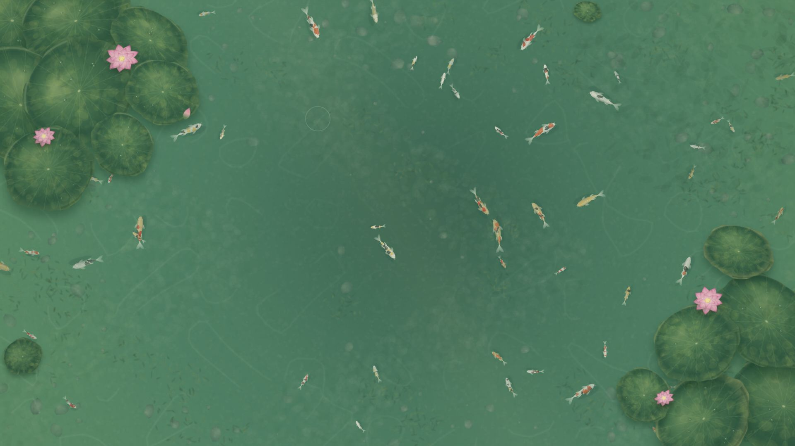

# Lotus Pond Wallpaper

A quiet, interactive lotus pond for your desktop. Written in plain JavaScript with Canvas 2D, with no build step or runtime downloads.



[Download for Lively](https://github.com/KR0817/lotus-pond-wallpaper/releases/latest) | [Short introduction video](https://github.com/KR0817/lotus-pond-wallpaper/releases/download/v1.0.0/Lotus-Pond-Introduction.mp4)

## Features

- Layered lotus leaves and blossoms, with independent gentle leaf motion.
- Jade water, submerged vegetation, soft shadows and animated light patterns.
- Koi with flexible bodies, varied markings, independent swimming states and changing apparent depth.
- Click to feed the koi. Only the fish that eats a pellet grows, smoothly approaching a maximum of 1.75 times its initial scale. Growth is saved locally. Move the pointer nearby to disturb them when shy-fish mode is enabled.
- Adjustable fish count, size, speed, colors, water hue and ripple strength through Lively.
- Fully local operation. No accounts, analytics or network requests from the wallpaper.

## Install with Lively Wallpaper (Windows)

1. Install [Lively Wallpaper](https://www.rocksdanister.com/lively/).
2. Download **Lotus-Pond-Lively-v1.1.0.zip** from [Releases](https://github.com/KR0817/lotus-pond-wallpaper/releases/latest).
3. In Lively, choose **Add Wallpaper**, then select or drag in the ZIP file.
4. Apply the wallpaper and use Lively's **Customize** panel to adjust it.

Alternatively, extract the ZIP and select `index.html` in Lively. The wallpaper was verified with Lively 2.2.1.0 on Windows. Lively and its WebView2 runtime are separate dependencies.

## Feeding and saved growth

One meal targets 1.09 times the starting size; ten meals target about 1.54 times. Unfed fish do not shrink. The size slider continues to scale the entire pond. This release contains only koi.

Meal counts are saved by fish slot in browser localStorage. Reducing and restoring the population retains those slots. Clearing browser data or importing into a different wallpaper storage location can reset growth. Lively must retain its WebView2 browser cache for saves to survive an app restart; hosts with storage disabled keep growth only for the current session. The save format remains compatible with the earlier local mixed-fish builds.

## Preview and edit

Open `index.html` directly in a modern browser. Edit `pond-scene.js` for scenery and `script.js` for fish drawing, motion and interaction. Browser preview uses defaults; the Lively settings panel is provided by Lively itself.

Defaults: **60 fish**, **size 0.36**, **speed 0.8**. The source retains the upstream Wallpaper Engine property bridge, but this release's packaged installation was tested with Lively, not Wallpaper Engine.

This is a procedural Canvas 2D illustration. It does not simulate volumetric 3D fish or physically accurate water refraction. Apparent depth uses tint, scale, ordering and shadows.

## Checks

The simulation checks require Node.js and no third-party packages:

```sh
node --check script.js
node --check pond-scene.js
node tests/behavior.cjs
node tests/motion.cjs
node tests/growth.cjs
```

The tests exercise turning, boundaries, feeding, swimming states, depth, growth limits, save restoration and malformed or unavailable storage. They do not replace visual inspection or establish a desktop FPS guarantee.

## Credits and license

Based on [Interactive Koi Pond](https://github.com/rzrabbi/interactive-koi-pond) by **Rezaye Rabbi (RzX)**, licensed under MIT. The original copyright notice is preserved in [LICENSE](LICENSE). This derivative adds lotus scenery, revised fish rendering, swimming behavior and depth effects. See [NOTICE.md](NOTICE.md).

The wallpaper source and the included project-created preview media are released under the **MIT License**. Lively, browsers and system fonts remain under their own licenses. No reference-video artwork, third-party music, Nagomi source/assets or courtyard/game assets are included.
